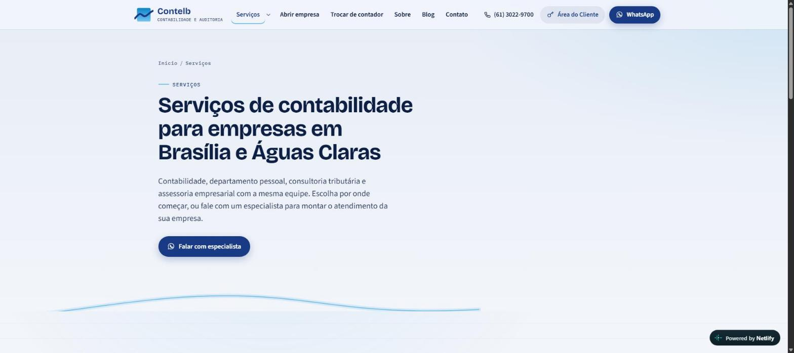

# Site da Contelb Contabilidade

Novo site institucional da Contelb Contabilidade (Águas Claras, Brasília/DF), construído com a skill **Site de 10K** e o briefing de redesign e SEO.

Páginas estáticas em HTML, CSS e JavaScript sem framework e sem dependências. Na hospedagem (KingHost), o blog e o painel do blog rodam em PHP 8.2, sem banco de dados. A pasta `site/` é o que vai para a pasta `www` da hospedagem.

## Demonstração visual

**Site no ar:** [mellow-meerkat-53f3de.netlify.app](https://mellow-meerkat-53f3de.netlify.app/)

| Página inicial | Serviços | Contato |
|:---:|:---:|:---:|
|  |  |  |

## Tecnologias utilizadas

- **HTML5, CSS3 e JavaScript** puros, sem framework e sem dependências, no site publicado (pasta `site/`).
- **Node.js** (sem dependências) no gerador de páginas (pasta `gerador/`).
- **PHP 8.2** (sem frameworks e sem banco de dados) no blog e no painel do blog, na KingHost.
- **Apache (`.htaccess`)** para HTTPS, redirecionamentos 301 e cache; publicação por FTP na **KingHost** (`publicar.bat` / `publicar.ps1` no Windows, `publicar.sh` no Mac/Linux) e pré-visualização no **Netlify** (`netlify.toml`).
- **JSON-LD, Open Graph e sitemap** para SEO local.
- **PowerShell** no servidor local de pré-visualização para Windows (`ver-site.ps1`).

## Estrutura

```
site/                  pasta de publicação (sobe para a www da KingHost)
  index.html           página inicial com o hero guiado por scroll
  sobre/ servicos/ abrir-empresa-brasilia/ trocar-de-contador/ ...
  blog/ contato/ politica-de-privacidade/ 404.html
  assets/css/site.css  todo o visual
  assets/js/site.js    hero, linhas animadas, abas, formulário, mapas
  assets/img/          fotos em AVIF, WebP e JPG, imagem de compartilhamento, logotipo
  assets/fonts/        fontes próprias (Bricolage Grotesque, Source Sans 3, IBM Plex Mono)
  .htaccess            HTTPS, www, redirecionamentos 301 das URLs .php antigas, cache, blog em PHP
  blog.php             blog dinâmico na KingHost (/blog/... e /blog-media/...)
  _blog/               biblioteca do blog e moldes exportados pelo gerador (bloqueada para visitantes)
  admin/               painel do blog: index.html, painel.js, api.php, instalar.php
  sitemap.xml robots.txt favicon.svg favicon.ico apple-touch-icon.png
gerador/               conteúdo e moldura das páginas (Node, sem dependências)
publicar.bat           publicação na KingHost no Windows (abre o menu do publicar.ps1)
publicar.ps1           publicação na KingHost via FTP (usa kinghost.env, que nunca vai para o Git)
publicar.sh            a mesma publicação, para Mac/Linux
```

## Como editar

Os textos vivem em `gerador/`:

- `dados.mjs`: telefone, e-mail, endereços, redes sociais, horário, lista de serviços e menu. NAP em um lugar só.
- `home.mjs`: página inicial.
- `servicos.mjs`: as oito páginas de serviço (contabilidade, trabalhista, assessoria, MEI, abrir empresa, trocar de contador, planejamento tributário, recuperação de créditos).
- `outras.mjs`: Sobre, hub de serviços, Contato, Política de privacidade e 404.
- `blog.mjs`: o blog do Netlify e o ponto de partida do blog da KingHost, com os 15 posts do blog original (título, data, categoria, resumo e texto completo), 8 por página, filtros por categoria, compartilhamento e uma página por post em `/blog/<slug>/`, o mesmo endereço do blog antigo.
- `posts/`: o texto de cada post, em HTML limpo. Foi gerado a partir da exportação do blog antigo com `python3 -I gerador/ferramentas/limpar-posts.py <pasta-exportada> gerador/posts`. Para um post novo: crie `posts/<slug>.html` e adicione uma linha no topo da lista `POSTS` em `blog.mjs` (e a imagem em `IMAGENS`, se houver).
- `layout.mjs`: cabeçalho, rodapé, metatags, Open Graph e dados estruturados (JSON-LD).

Depois que o site estiver na KingHost, **os artigos do blog passam a ser editados só pelo painel** (`/admin/`). Os 15 posts de `gerador/` são copiados para o servidor uma única vez, na primeira visita ao blog; mudanças posteriores em `gerador/posts/` não alteram o blog no ar.

Depois de editar, gere as páginas de novo:

```
node gerador/gerar.mjs
```

## Pré-visualizar

No Windows, dê dois cliques em `ver-site.bat`. Ele liga um servidor local feito só com o PowerShell do próprio Windows (`ver-site.ps1`, nada para instalar) e abre o navegador em `http://localhost:8080`. Deixe a janela preta aberta enquanto olha o site.

No PowerShell, os comandos vão em linhas separadas:

```
cd site
py -m http.server 8080
```

No Mac ou Linux: `cd site && python3 -m http.server 8080`.

Abra `http://localhost:8080`. Um servidor local é necessário porque os links usam caminhos a partir da raiz (`/sobre/`, `/assets/...`), como no site no ar.

## Blog e painel na KingHost

O Netlify só mostra arquivos prontos; na KingHost o blog é montado pelo PHP a cada visita, com o mesmo HTML, os mesmos endereços e o mesmo SEO das páginas geradas pelo Node.

- **Onde ficam os dados:** em `/home/contelb/dados-blog/`, **fora** da pasta pública `www`: `posts/` (um JSON por artigo), `midia/` (imagens, PDFs e vídeos enviados pelo painel, servidos em `/blog-media/`), `usuarios.json` (contas do painel, com senha criptografada) e `sessoes/`. Se essa pasta não puder ser criada, o blog usa `www/_blog/dados/`, que também é bloqueada para visitantes.
- **Painel:** `https://www.contelb.com.br/admin/`. Cria, edita, publica e despublica artigos, envia capa e arquivos (até 3 MB) e incorpora vídeos do YouTube ou Vimeo. Um artigo em rascunho não aparece no site, na lista nem no sitemap.
- **Segurança do painel:** sem senha no código; login com limite de 5 erros em 15 minutos; sessão de 2 horas em cookie seguro (`Secure`, `HttpOnly`, `SameSite=Strict`); proteção contra pedidos de outros sites (origem e token CSRF); o HTML dos artigos é limpo no navegador (DOMPurify) e de novo no servidor, e só aceita imagens e vídeos enviados pelo próprio painel; arquivos enviados são conferidos pelo conteúdo real, não pela extensão.
- **Criar ou redefinir as contas do painel:** rode a opção 4 do `publicar.bat` (ou `./publicar.sh instalar`). Ela grava um código de uso único, válido por 24 horas, em `dados-blog/instalar.codigo` e mostra o código na tela. Abra `/admin/instalar.php`, cole o código e crie até duas contas. O código é apagado depois do uso. Cada pessoa pode trocar a própria senha no painel em "Trocar senha".
- **Cópia de segurança do blog:** de tempos em tempos, baixe a pasta `dados-blog` pelo WebFTP da KingHost. Os artigos novos existem só lá (não ficam no Git).
- **Netlify:** continua só como pré-visualização. Lá não há PHP, então `/admin/`, `/_blog/` e `/blog.php` respondem como página inexistente e o blog mostrado é a cópia estática gerada pelo Node.

## Publicar (KingHost)

Domínio `contelb.com.br`, FTP `web10f33.kinghost.net` (o certificado do FTP não vale para `ftp.contelb.com.br`), usuário `contelb`, pasta pública `www`. O FTP entra em `/www`, e a raiz fica um nível acima (`/home/contelb` no servidor); por isso os scripts usam caminhos absolutos. As regras do `.htaccess` valem só para `contelb.com.br` e `www.contelb.com.br`, então não afetam subdomínios como `wd.contelb.com.br`. Os scripts não movem nenhum item chamado `wd`, mas em 04/11/2026 não existia pasta `www/wd`.

1. Copie `kinghost.env.exemplo` para `kinghost.env`. Esse arquivo está no `.gitignore` e nunca vai para o Git. A senha do FTP pode ficar em branco: nesse caso ela é pedida na tela a cada uso.
2. No Windows, dê dois cliques em `publicar.bat` e escolha a opção. No Mac/Linux, use `./publicar.sh <opção>`.
   1. **Listar**: só mostra o que existe hoje no FTP. Não muda nada.
   2. **Mover o site antigo para a reserva**: move tudo o que está na `www` (menos `wd` e `.well-known`) para `/www_antigo_AAAAMMDD-HHMM`, fora do site público. Inclui o blog antigo da Sitecontabil e as páginas `.php`. Nada é apagado. Pede para digitar `MOVER`.
   3. **Publicar**: envia `site/` para a `www`, inclusive o `.htaccess`, menos `site/blog/` (cópia estática usada só no Netlify). Pede para digitar `PUBLICAR`. No Windows, o script também confere o tamanho de cada arquivo no servidor e reenvia os que chegaram diferentes, até 3 tentativas.
   4. **Criar código de instalação** das contas do painel (veja acima).
3. Se o Varnish estiver ativo no painel da KingHost, limpe o cache. Em 04/11/2026 ele estava desativado: não clique em "Ativar", porque isso redefine as entradas de DNS. Depois teste em uma janela anônima: a página inicial, `/blog/`, um artigo, `/admin/`, `wd.contelb.com.br` e um endereço antigo, como `/sobre-nos.php` (deve ir para `/sobre/`).

A conexão FTP é sempre protegida (TLS). No Windows, o `publicar.ps1` limita a conexão ao TLS 1.2: com TLS 1.3, o curl do Windows cortou arquivos no envio sem avisar erro. Os scripts não apagam nada no servidor: só criam pastas, enviam arquivos e movem itens com confirmação.

**Para voltar atrás:** no WebFTP da KingHost, mova os itens da `www` (menos `wd`) para uma pasta nova, como `www_novo`, e devolva para a `www` os itens da pasta `www_antigo_...`. O backup completo da hospedagem (já feito) só deve ser restaurado em último caso.

## SEO implementado

- Title e meta description únicos por página, canonical absoluto, um H1 por página, hierarquia H1 > H2 > H3.
- URLs amigáveis sem `.php` e redirecionamento 301 de todas as URLs antigas.
- JSON-LD: `Organization`, dois `AccountingService` (matriz e filial, que são `LocalBusiness`) com `PostalAddress`, `WebSite`, `WebPage`, `BreadcrumbList`, `Service`, `FAQPage` e `BlogPosting`.
- `sitemap.xml`, `robots.txt`, Open Graph e Twitter Cards com imagem 1200x630.
- NAP idêntico no rodapé, na página de contato e nos dados estruturados.
- Sitemap do blog gerado na hora (`/blog/sitemap.xml`), com os artigos publicados pelo painel; `/admin/` fora do Google (`robots.txt` e `X-Robots-Tag`).
- Imagens AVIF e WebP com dimensões definidas, `lazy` fora da primeira tela e texto alternativo descritivo.

## Pendências para confirmar com a Contelb

Jurídico e LGPD (checklist revisado em 21/10/2026):
- Preencher razão social, CNPJ e registros no CRC (escritório e responsável técnico) em `gerador/dados.mjs`. Eles aparecem sozinhos no rodapé, na política de privacidade, nos termos de uso e nos dados estruturados.
- Pedir revisão de um advogado para `/politica-de-privacidade/` e `/termos-de-uso/` antes de publicar.
- Confirmar autorização dos três clientes citados nos depoimentos (nome e resumo) e, se possível, receber o texto exato.
- Confirmar a licença das imagens: banner do topo, fotos do blog (uma delas é um quadro de telejornal com logotipo de emissora, e o arquivo original de outra se chamava "adobe_stock") e autorização de imagem das pessoas nas fotos das salas.
- Confirmar se os textos do blog podem ser republicados no site novo: vários parecem vir de terceiros e do serviço de blog anterior (Sitecontabil). Se for o caso, incluir a fonte em cada post ou trocar por textos próprios.
- Revisar as promessas de processo das páginas de serviço (prazos, conferências, avisos) para garantir que descrevem a rotina real do escritório.

- Blog: na publicação, o blog antigo em `www/blog` sai do ar e fica guardado na pasta de reserva (opção 2 do `publicar.bat`), porque o novo site passa a servir os mesmos endereços.

- Horário de atendimento (hoje: "Segunda a sexta, em horário comercial"), em `gerador/dados.mjs`.
- Número de registro no CRC do escritório e do responsável técnico, para incluir no rodapé.
- Textos completos dos depoimentos (hoje aparecem como resumo, sem aspas, e sem marcação `Review`).
- Quem aparece nas fotos das salas, se for preciso citar no texto.
- A imagem do topo da página inicial é a do banner do site anterior e ilustra um ambiente empresarial; o ideal é trocar por uma foto real do Edifício Contelb.
